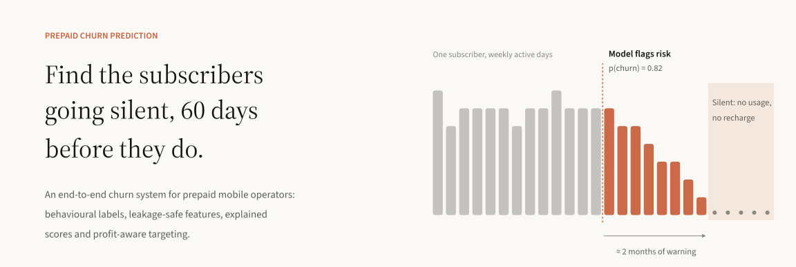
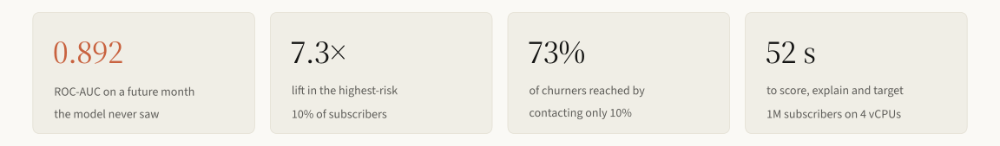
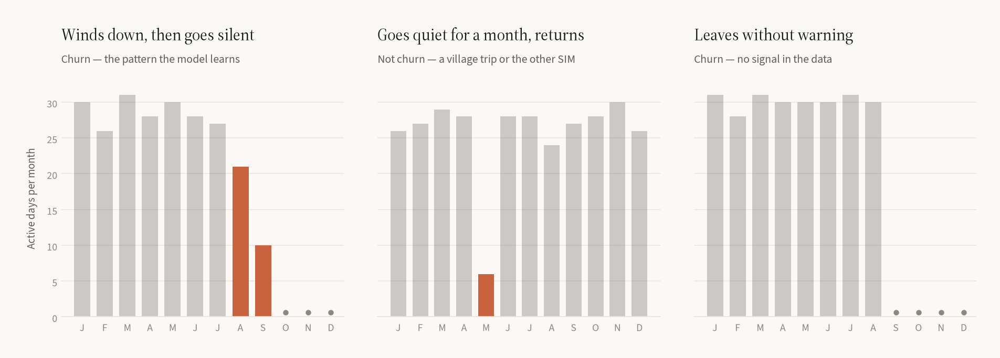
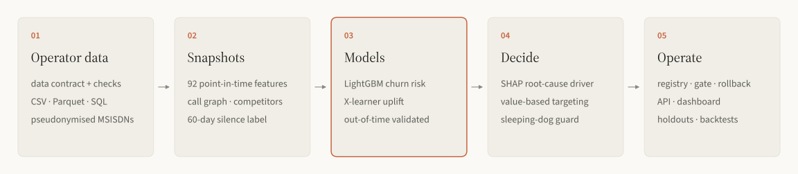
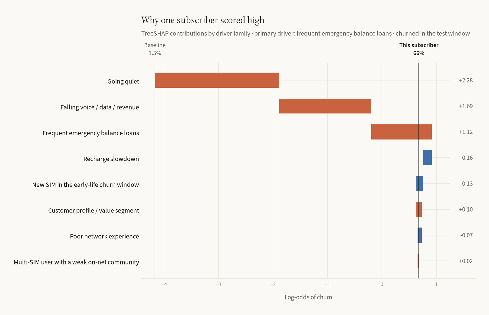

<picture>
  <source media="(prefers-color-scheme: dark)" srcset="docs/assets/hero-dark.svg">
  
</picture>

<p align="center">
  <a href="#overview">Overview</a> ·
  <a href="#why-prepaid-churn-is-hard">The problem</a> ·
  <a href="#approach">Approach</a> ·
  <a href="#results">Results</a> ·
  <a href="#quickstart">Quickstart</a> ·
  <a href="docs/interview_guide.md">Interview guide</a>
</p>

<p align="center">
  <a href="https://github.com/noushad999/telecom-churn-prediction/actions/workflows/ci.yml"></a>
  
  
</p>

<picture>
  <source media="(prefers-color-scheme: dark)" srcset="docs/assets/stats-dark.svg">
  
</picture>

## Overview

In prepaid mobile markets like Bangladesh, where more than 95% of connections are prepaid, customers rarely cancel. They stop recharging, move their spending to a second SIM, and go quiet. By the time a CRM team notices, the subscriber is already gone.

This repository is a complete system for catching them early. It learns from the behaviour an operator already records (usage, recharges, network experience, competitor activity) and flags subscribers who are likely to go silent in the next 60 days. It explains each flag in business terms and recommends who is worth a retention offer. Four principles shape the design:

- **Churn is observed, not labelled.** A subscriber is a churner if they have zero usage *and* zero recharge for 60 days after a snapshot. No `Churn = Yes/No` column exists in real prepaid data, so none is used here.
- **Evaluation matches deployment.** Features are point-in-time and tested for leakage. The model is scored on a future month it never saw, and probabilities are never distorted by resampling.
- **Every score carries a reason.** Per-subscriber SHAP values roll up into drivers a retention team can act on, such as a new SIM, a bad network experience or a competitor offer.
- **Contact decisions are economic.** A subscriber is contacted only when the expected value of saving them exceeds the cost of trying.

## Why prepaid churn is hard



<sub><b>Figure 1.</b> Monthly active days for three real subscribers from the simulated operator. Clay bars mark months of reduced activity; dots mark months with no activity at all.</sub>

The model's job is to tell the first pattern from the second. Both show a sharp drop in activity. Only one ends in churn. The third pattern is the irreducible floor: some subscribers leave with no behavioural warning, and no model can catch them from usage data alone. The data here is built to contain all three, so the reported numbers are honest about that limit rather than inflated by an easy problem.

## Approach

<picture>
  <source media="(prefers-color-scheme: dark)" srcset="docs/assets/pipeline-dark.svg">
  
</picture>

**01 · Operator data.** Subscriber-level telco data can't be published, so `churn simulate` generates the four extracts a churn team would pull from an operator's data warehouse. They have the same grain and columns. Churn *emerges* from behaviour, driven by:

- tenure and early-life SIMs
- multi-SIM use and on-net community strength
- call drops and complaints
- a competitor data-pack campaign in two divisions
- a July tariff change hitting price-sensitive users
- Eid-season dormancy

| Table | Grain | Rows (300k base, 12 months) |
|:--|:--|--:|
| `subscribers` | SIM: activation, division, handset, plan, dual-SIM, app & MFS use | 426k |
| `usage_monthly` | subscriber × active month: voice, data, SMS, revenue, active days, complaints, call drops | 4.0M |
| `recharges` | top-up transaction: timestamp, denomination, channel | 10M |
| `network_market` | division × month: drop rate, outages, competitor promotions | 96 |

**02 · Snapshots.** One row per subscriber active in the cutoff month, with 82 features computed only from data up to that month's last day:

- recency and active-day trends
- recharge gaps and ticket sizes, from raw transactions
- usage trends
- experienced network quality
- competitor pressure
- credit stress

A test deletes every record after the cutoff and asserts that no feature changes.

**03 · Model.** LightGBM is trained on five monthly snapshots (March–July, 1.56M rows), early-stopped on August, and evaluated on October. That mirrors production: standing at the end of October, August is the latest month whose 60-day outcome is known. Logistic regression and the classic "days since last recharge" rule are trained and evaluated alongside as baselines.

**04 · Explain & decide.** TreeSHAP contributions are grouped into driver families. The strongest *root cause* picks the offer (see [below](#explaining-every-score)), and expected value decides who receives one.

**05 · Serve & monitor.** A monthly batch job writes scores and a CRM-ready campaign list. A FastAPI service scores on demand. Population Stability Index checks flag drift before accuracy decays.

## Results

All numbers come from **October**, a month excluded from training and model selection. It has 302,470 active subscribers, 3.9% of whom churned.

<div align="center">

| | **LightGBM** | Logistic regression | Recency rule |
|:--|:--:|:--:|:--:|
| ROC-AUC | **0.892** | 0.868 | 0.780 |
| PR-AUC | **0.552** | 0.404 | 0.256 |
| KS statistic | **0.661** | 0.616 | 0.407 |
| Precision in the top 5% | **48.7%** | 40.1% | 33.3% |
| Churners reached by contacting 10% | **73.2%** | 67.6% | 48.9% |
| Net campaign value | **+201k ৳** | – | negative at every depth |

</div>

<p align="center">
  
  
</p>

<sub><b>Figure 2.</b> Left: share of churners reached as the campaign grows, highest risk first. Right: realised net value of a retention campaign by targeting depth. The same campaign economics apply to every ranking.</sub>

The model concentrates risk sharply. The highest-risk decile has a churn rate of 28.5%, 7.3 times the base rate, and holds 73% of all churners. Because the scores are calibrated (Brier 0.024), they can be used directly as probabilities in the targeting maths. The resulting policy contacts 2.8% of the base and lands within 0.4% of the best outcome achievable in hindsight. On the same month:

- the recency rule never turns a profit at any depth
- random targeting of the same size loses 191k ৳
- a blanket offer to every subscriber loses 6.9M ৳

<details>
<summary><b>ROC and precision–recall curves, calibration, decile table</b></summary>
<br>


<p align="center"></p>

| Decile | Subscribers | Churners | Churn rate | Lift | Cumulative capture |
|:--:|--:|--:|--:|--:|--:|
| 1 | 30,247 | 8,633 | 28.5% | 7.32 | 73.2% |
| 2 | 30,247 | 898 | 3.0% | 0.76 | 80.8% |
| 3 | 30,247 | 542 | 1.8% | 0.46 | 85.4% |
| … | | | | | |
| 10 | 30,247 | 107 | 0.4% | 0.09 | 100% |

Full metrics: [`reports/metrics.json`](reports/metrics.json) · [`reports/gains_test.csv`](reports/gains_test.csv)

</details>

## Explaining every score

A retention agent can't act on `rch_max_gap_days_90d = +0.41`. So each subscriber's TreeSHAP values are summed into nine driver families.

<p align="center">
  
  
</p>

<sub><b>Figure 3.</b> Left: average influence of each driver family across the base. Right: how one subscriber's score builds up from the baseline. Their activity is fading, and the root cause the offer should address is credit stress.</sub>

Driver families come in two kinds:

- **Symptoms:** going quiet, spending less, recharging less.
- **Causes:** a new SIM, a poor network experience, a competitor offer, credit stress, multi-SIM behaviour.

Symptoms carry most of the predictive weight, but an offer only works if it addresses a cause. Each subscriber's `primary_driver` is therefore their strongest cause, falling back to the strongest symptom when no cause stands out.

| Primary driver | Recommended action |
|:--|:--|
| `early_life` | Onboarding journey: bonus on 2nd/3rd recharge, app sign-up reward |
| `network_experience` | Proactive care call, ticket for the serving site, goodwill minutes |
| `competitor_pressure` | Geo-targeted, price-matched data-pack counter-offer |
| `credit_stress` | Higher emergency-balance limit, micro packs |
| `multi_sim_low_loyalty` | "Primary SIM" loyalty offer: on-net minutes and FnF bonus |
| symptom fallback | Recharge bonus, win-back nudge or usage bundle |

## Deciding who to contact

```
value_if_saved = save_rate × margin × ARPU × 6 months
cost           = contact cost + redeem_rate × offer cost
expected_net   = p(churn) × value_if_saved − cost          contact only if > 0
```

This is why a subscriber at 40% risk paying 800 ৳ a month can outrank one at 90% risk paying 30 ৳. Every assumption lives in [`configs/config.yaml`](configs/config.yaml).

## Serving and monitoring

```bash
churn score --month 2025-12      # scores + CRM campaign list + drift report
churn serve                      # FastAPI on :8000, docs at /docs
```

```bash
curl localhost:8000/v1/subscribers/138803
```
```json
{
  "sub_id": 138803, "tenure_months": 166, "arpu_3m": 499.0,
  "churn_probability": 0.819, "risk_band": "critical", "expected_net_value": 378.6, "target": true,
  "reasons": [
    {"code": "inactivity",    "description": "Going quiet: fewer active days, long time since last activity"},
    {"code": "usage_decline", "description": "Falling voice / data / revenue"}
  ],
  "primary_driver": "multi_sim_low_loyalty",
  "recommended_action": "'Primary SIM' loyalty offer: on-net minutes + FnF bonus"
}
```

| Endpoint | Purpose |
|:--|:--|
| `POST /v1/predict` | Score up to 10k feature vectors with reasons and action |
| `GET /v1/subscribers/{id}` | Latest batch score, for call-centre and CRM lookups |
| `GET /v1/model` | Model version, training window, test metrics, features |
| `GET /health` | Liveness |

**Training–serving consistency.** Feature order, category levels and risk thresholds are frozen into the model artifact. Nothing is re-fitted at inference, and unknown values become missing rather than errors.

**Drift monitoring.** Every scoring run compares each feature and the score distribution with the validation month using the Population Stability Index:

| PSI | Meaning |
|:--|:--|
| < 0.10 | Stable |
| 0.10–0.25 | Investigate |
| > 0.25 | Retrain |

### Performance

| Workload, 4 vCPU container | Time |
|:--|--:|
| Monthly run for **1M subscribers**: features, scores, reasons, campaign list, drift | **52 s** |
| Monthly run for 300k subscribers | 15 s |
| Training on 1.56M rows × 82 features | ~60 s |
| Scoring throughput, without reasons | ~120k subscribers/s |
| API request with reason codes | ~3 ms model, ~5 ms end to end |

## Quickstart

```bash
git clone https://github.com/noushad999/telecom-churn-prediction.git
cd telecom-churn-prediction
python -m venv .venv && source .venv/bin/activate
pip install -e ".[dev]"

churn pipeline                 # simulate a 300k-subscriber operator, train, score  (~3 min)
churn serve                    # scoring API at http://localhost:8000/docs
pytest                         # 20 tests, ~10 s
python docs/assets/make_figures.py   # regenerate the README figures
```

For an operator-scale run, use `churn pipeline --subscribers 1000000`.

<details>
<summary><b>Repository layout</b></summary>
<br>

```
configs/config.yaml       simulation, churn definition, splits, model, campaign economics, risk bands
src/churn/
  simulate.py             behavioural operator-DWH simulator
  features.py             point-in-time snapshots and the 60-day silence label
  train.py                out-of-time training, baselines, evaluation, artifact export
  evaluate.py             AUC, PR-AUC, KS, lift, capture, charts
  explain.py              SHAP → driver families → root cause → action
  campaign.py             expected-value targeting and profit curves
  model.py                frozen model artifact, fast NumPy inference
  score.py                monthly batch scoring, campaign list, drift report
  monitor.py              Population Stability Index
  api.py                  FastAPI service
  style.py                shared visual style for charts and figures
tests/                    leakage, label definition, simulator invariants, business logic, API
reports/                  metrics and charts from the reference run
docs/                     README figures, interview guide
```

</details>

## Using real operator data

Provide the four tables with the same schemas and replace `simulate.load_tables`. Features, training, scoring and the API run unchanged. A production deployment would typically also:

1. Build snapshots in the warehouse or a feature store.
2. Align the silence window with the finance definition of churn.
3. Measure the save rate with randomised hold-out groups.
4. Retrain on drift alerts or decaying realised lift.

## Limitations

- **The data is simulated.** The simulator encodes how prepaid markets behave, but the absolute figures illustrate the method; they are not any operator's results. What transfers is the design: the label, the leakage controls, the evaluation, the explanations and the economics.
- **The retention effect is assumed.** Campaign value uses a fixed save rate. Real programmes need hold-out groups, and ultimately uplift models that find subscribers who can be persuaded rather than merely those at risk.
- **Reasons explain the model, not the world.** A driver says why the model scored a subscriber highly. That is a hypothesis for the retention team, not a causal finding.

## Next steps

- Uplift modelling on campaign response data
- Call-graph features: churn spreads through frequent contacts
- Time-to-churn survival modelling for lifetime-value-aware offers
- Experiment tracking and scheduled retraining

## Citation

```bibtex
@software{ramim2025telcochurn,
  author = {Md Noushad Jahan Ramim},
  title  = {Telecom Churn Prediction: finding prepaid subscribers before they go silent},
  year   = {2025},
  url    = {https://github.com/noushad999/telecom-churn-prediction}
}
```

## License

Code is released under the MIT license. Bundled fonts (Source Serif 4, Source Sans 3) are under the SIL Open Font License. Built in Dhaka, Bangladesh.
