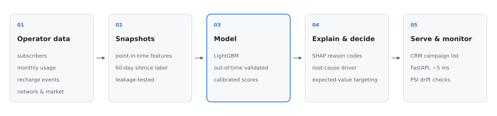

<div align="center">

# Telecom Churn Prediction

**Predicting prepaid subscriber churn 60 days before it happens, and deciding what to do about it.**

[](https://github.com/noushad999/telecom-churn-prediction/actions/workflows/ci.yml)


[Overview](#overview) · [Results](#results) · [Quickstart](#quickstart) · [How it works](#how-it-works) · [Serving](#serving--monitoring) · [Interview guide](docs/interview_guide.md)

<br>

<picture>
  <source media="(prefers-color-scheme: dark)" srcset="docs/assets/overview-dark.svg">
  
</picture>

</div>

## Overview

In prepaid mobile markets like Bangladesh, where more than 95% of connections are prepaid, customers don't cancel. They stop recharging, move to their second SIM, and go quiet. By the time a CRM team notices, the subscriber is gone.

This repository is an end-to-end system for that problem. It is designed the way an operator's data science team would build it:

- **Churn is defined from behaviour.** A subscriber active this month is labelled churn if they have zero usage *and* zero recharge for the next 60 days. There is no `Churn = Yes/No` column to lean on.
- **Evaluation is honest.** Features are point-in-time and leakage-tested. The model is judged on a future month it has never seen. No resampling distorts the probabilities.
- **Every score comes with a reason and an action.** TreeSHAP contributions roll up into business drivers (early-life SIM, network experience, competitor offer, credit stress, multi-SIM) and map to a next-best offer.
- **Targeting is decided by money, not risk alone.** Subscribers are contacted only when `p(churn) × value_if_saved − cost > 0`.
- **It is built for operator scale.** A full monthly run over **1M subscribers takes 52 seconds** on 4 vCPUs. The API answers in about 5 ms.

## Results

Evaluated on an **untouched future month** (October: 302,470 active subscribers, 3.9% churn), after training on March–July and early stopping on August.

<div align="center">

| | **LightGBM** | Logistic regression | Recency rule¹ |
|:--|:--:|:--:|:--:|
| ROC-AUC | **0.892** | 0.868 | 0.780 |
| PR-AUC | **0.552** | 0.404 | 0.256 |
| KS statistic | **0.661** | 0.616 | 0.407 |
| Precision, top 5% of base | **48.7%** | 40.1% | 33.3% |
| Churners captured, top 10% of base | **73.2%** | 67.6% | 48.9% |
| Campaign net value² | **+201k ৳** | – | < 0 at every depth |

</div>

<sub>¹ Rank by days since last recharge, the typical pre-ML CRM rule. ² Same campaign economics for every model. On the same month, random targeting of the same size loses 191k ৳ and a blanket offer to the whole base loses 6.9M ৳.</sub>

<p align="center">
  
  
</p>

The top decile contains **28.5% churners (7.3× the base rate) and 73% of all churners**. Probabilities are well calibrated (Brier 0.024), and the expected-value targeting relies on that. The targeting policy picks 2.8% of the base and lands within 0.4% of the best profit achievable in hindsight.

<details>
<summary><b>More: ROC / PR curves, calibration, gains table</b></summary>
<br>

<p align="center"></p>
<p align="center"></p>

| Decile | Subscribers | Churners | Churn rate | Lift | Cumulative capture |
|:--:|--:|--:|--:|--:|--:|
| 1 | 30,247 | 8,633 | 28.5% | 7.32 | 73.2% |
| 2 | 30,247 | 898 | 3.0% | 0.76 | 80.8% |
| 3 | 30,247 | 542 | 1.8% | 0.46 | 85.4% |
| … | | | | | |
| 10 | 30,247 | 107 | 0.4% | 0.09 | 100% |

Full metrics: [`reports/metrics.json`](reports/metrics.json) · [`reports/gains_test.csv`](reports/gains_test.csv)

</details>

### Performance

| Workload (4 vCPU container) | Time |
|:--|--:|
| Monthly scoring run, **1M active subscribers** (12M usage rows, 30M recharge events) | **52 s** · 4.6 GB peak |
| Monthly scoring run, 300k subscribers (features, scores, reason codes, campaign list, drift) | 15 s |
| Model training, 1.56M rows × 82 features | ~60 s |
| Raw scoring throughput | ~120k subscribers/s |
| API, single subscriber incl. SHAP reason codes | ~3 ms model · ~5 ms HTTP p50 |

## Quickstart

```bash
git clone https://github.com/noushad999/telecom-churn-prediction.git && cd telecom-churn-prediction
python -m venv .venv && source .venv/bin/activate
pip install -e ".[dev]"

churn pipeline      # simulate a 300k-subscriber operator → train → score   (~3 min)
churn serve         # scoring API at http://localhost:8000/docs
pytest              # 20 tests, ~10 s
```

`churn pipeline --subscribers 1000000` runs at operator scale. The Makefile has shortcuts: `make pipeline`, `make serve`, `make test`, `make docker`.

## How it works

### 1 · Data

Subscriber-level telco data can't be published, so `churn simulate` generates the four extracts a churn team would pull from an operator's data warehouse. They have the same grain and the same columns, and churn *emerges* from behaviour instead of being assigned at random.

| Table | Grain | Rows (300k base, 12 months) |
|:--|:--|--:|
| `subscribers` | SIM: activation, division, handset, plan, dual-SIM, app & MFS use | 426k |
| `usage_monthly` | subscriber × active month: voice, data, SMS, revenue, active days, complaints, call drops, data speed | 4.0M |
| `recharges` | top-up transaction: timestamp, denomination (10, 20, 29, 49, 99 … ৳), channel | 10M |
| `network_market` | division × month: call-drop rate, outages, competitor promotions | 96 |

<details>
<summary><b>What drives churn in the simulator</b></summary>
<br>

Each month, a subscriber's hazard of starting to disengage depends on:

- tenure (early-life SIMs churn most), engagement and ARPU
- multi-SIM behaviour and on-net community share
- accumulated dissatisfaction from call drops and complaints
- **competitor promotions** in their division (e.g. a data-pack blitz in Rajshahi & Rangpur, Aug–Sep)
- a **July tariff hike** that hits price-sensitive users
- plan type, self-care app adoption, and an unobserved frailty term

Disengaging subscribers wind usage and recharges down over 0–3 months, then go silent. To keep the problem realistically hard:

- some churn abruptly with no warning
- some recover
- ~4% of loyal users have a *temporary dormant month* (Eid village trip, using the other SIM, travel abroad) that looks like churn but isn't
- Eid usage peaks, occasional low-activity users, and rural network penalties add further noise

</details>

### 2 · Label and snapshots

```
            lookback: features only            label window
        ┌───────────────────────────────┐ ┌─────────────────────┐
          Aug        Sep        Oct ◄ cutoff    Nov        Dec
                                  │
   active in Oct ─────────────────┘    churn = 1  ⇔  no usage and no recharge in Nov–Dec
```

- Each snapshot has one row per subscriber active in the cutoff month.
- Features read only data up to the cutoff's last day. A test deletes everything after the cutoff and asserts every feature value is unchanged.
- The split is **out-of-time**, as it would run in production. Standing at the end of October, labels exist only for cutoffs up to August. So the model trains on March–July (1.56M rows), early-stops on August, and is evaluated on October.

### 3 · Features

82 features in seven families:

- **Activity & recency:** days since last activity, active-day trends
- **Recharge behaviour** (from raw transactions): gaps, counts, amount trend, small-ticket share, MFS share
- **Usage trends:** voice, data, revenue, on-net share
- **Network experience:** drops, speed, complaints, regional deterioration
- **Competitor pressure**
- **Credit stress:** emergency balance loans
- **Profile & tenure**

Months before activation are treated as *unknown*, not zero, so trends aren't fabricated for new SIMs.

### 4 · Model

LightGBM (31 leaves, depth 6, early stopping on the validation month), compared against logistic regression and the recency rule. Shallow trees are a deliberate choice: accuracy is unchanged, and TreeSHAP runs several times faster.

### 5 · From score to action

A retention agent can't act on `rch_max_gap_days_90d = +0.41`. So per-subscriber TreeSHAP values are summed into business driver families.

<p align="center"></p>

These families are either **symptoms** (going quiet, spending less, recharging less) or **root causes** (early-life SIM, network experience, competitor offer, credit stress, multi-SIM). Symptoms dominate the score, but the offer has to fix the cause. So each subscriber's `primary_driver` is their strongest root cause, falling back to the strongest symptom when no cause stands out.

| Primary driver | Next-best action |
|:--|:--|
| `early_life` | Onboarding journey: bonus on 2nd/3rd recharge, app sign-up reward |
| `network_experience` | Proactive care call, ticket for the serving site, goodwill minutes |
| `competitor_pressure` | Geo-targeted, price-matched data-pack counter-offer |
| `credit_stress` | Higher emergency-balance limit, micro packs |
| `multi_sim_low_loyalty` | "Primary SIM" loyalty offer: on-net minutes + FnF bonus |
| symptom fallback | Recharge bonus / win-back nudge / usage bundle |

### 6 · Who to contact

```
value_if_saved = save_rate × margin × ARPU × 6 months
cost           = contact cost + redeem_rate × offer cost
expected_net   = p(churn) × value_if_saved − cost        →  contact only if > 0
```

This is why a 40%-risk subscriber paying 800 ৳/month can outrank a 90%-risk subscriber paying 30 ৳. All assumptions live in [`configs/config.yaml`](configs/config.yaml). `save_rate` is an assumption here; in production it is measured with a randomised hold-out group (see [Limitations](#limitations)).

## Serving & monitoring

**Batch** — `churn score --month 2025-12` writes two files:

- `outputs/scores_<month>.parquet`: every active subscriber, with probability, risk band, rank and expected value
- `outputs/campaign_<month>.csv`: the targeted list with reasons, primary driver and recommended action, ready for a CRM or campaign tool

**Real-time** — `churn serve` starts a FastAPI service:

```bash
curl localhost:8000/v1/subscribers/138803
```
```json
{
  "sub_id": 138803, "division": "Dhaka", "tenure_months": 166, "arpu_3m": 499.0,
  "churn_probability": 0.819, "risk_band": "critical", "expected_net_value": 378.6, "target": true,
  "reasons": [
    {"code": "inactivity",    "description": "Going quiet: fewer active days, long time since last activity"},
    {"code": "usage_decline", "description": "Falling voice / data / revenue"}
  ],
  "primary_driver": "multi_sim_low_loyalty",
  "recommended_action": "'Primary SIM' loyalty offer: on-net minutes + FnF bonus"
}
```

| Endpoint | Purpose |
|:--|:--|
| `POST /v1/predict` | Score up to 10k feature vectors on demand, with reasons and action |
| `GET /v1/subscribers/{id}` | Look up the latest batch score (call-centre / CRM) |
| `GET /v1/model` | Model version, training window, test metrics, feature list |
| `GET /health` | Liveness |

**Consistency** — Feature order, category levels and risk thresholds are frozen in the model artifact, and nothing is re-fitted at inference. Unknown categories and missing features become `NaN`. Inference runs on a dense NumPy matrix and bypasses pandas: 0.04 ms per prediction.

**Drift** — Every scoring run computes the Population Stability Index for each feature and for the score against the validation month:

| PSI | Meaning |
|:--|:--|
| < 0.10 | Stable |
| 0.10–0.25 | Investigate |
| > 0.25 | Retrain |

## Repository layout

```
configs/config.yaml       simulation, churn definition, splits, model, campaign economics, risk bands
src/churn/
  simulate.py             behavioural operator-DWH simulator (vectorised NumPy → parquet)
  features.py             point-in-time snapshots and the 60-day inactivity label (Polars)
  train.py                out-of-time training, baselines, evaluation, artifact export
  evaluate.py             AUC, PR-AUC, KS, lift, capture, gains table, charts
  explain.py              SHAP → driver families → root cause → next-best action
  campaign.py             expected-value targeting and profit curves
  model.py                frozen model artifact with a fast NumPy inference path
  score.py                monthly batch scoring, campaign list, drift report
  monitor.py              PSI drift monitoring
  api.py                  FastAPI service
  cli.py                  churn simulate | train | score | pipeline | serve
tests/                    leakage, label definition, simulator invariants, business logic, API
reports/                  metrics and charts from the reference run
docs/interview_guide.md   design decisions and the questions a telco panel will ask
```

## Using real operator data

Provide the four tables above with the same schemas and replace `simulate.load_tables`. Everything downstream (features, training, scoring, API) runs unchanged. In a production deployment you would typically also:

1. Build snapshots in the warehouse (Spark, BigQuery) or a feature store instead of in-memory Polars.
2. Align the churn window with the finance definition (60 vs 90 days, revenue-generating events only).
3. Measure `save_rate` and offer costs from randomised control groups.
4. Schedule monthly retraining, triggered by PSI alerts or decaying realised lift.

## Limitations

- **The data is simulated.** The simulator encodes the mechanics of prepaid markets, but absolute figures (AUC, ৳) demonstrate the method; they are not any operator's results. What transfers is the system design.
- **Retention effect is assumed, not measured.** Campaign value assumes a fixed `save_rate`. Real programmes need hold-out groups, and ultimately uplift models that target *persuadable* subscribers rather than merely risky ones.
- **Reason codes explain the model, not the world.** They say why the model scored a subscriber highly, which is a hypothesis for the retention team, not a causal finding.

## Roadmap

- [ ] Uplift modelling (T-/X-learner) on campaign response data
- [ ] Call-graph features: churn spreads through frequent contacts
- [ ] Survival model (time-to-churn) for CLV-aware offers
- [ ] Experiment tracking (MLflow) and orchestration (Airflow/Prefect)

## Citation

```bibtex
@software{ramim2025telcochurn,
  author = {Md Noushad Jahan Ramim},
  title  = {Telecom Churn Prediction: an end-to-end prepaid churn system},
  year   = {2025},
  url    = {https://github.com/noushad999/telecom-churn-prediction}
}
```

## License

MIT. Built in Dhaka, Bangladesh.
