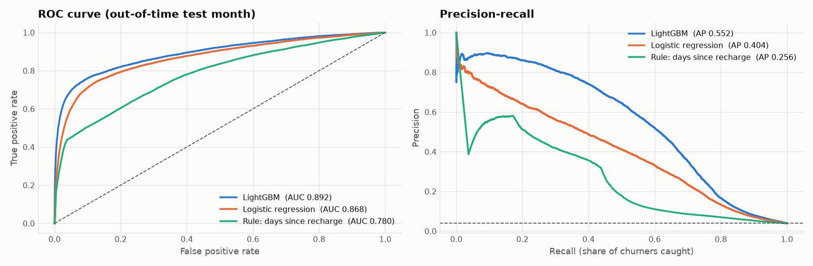
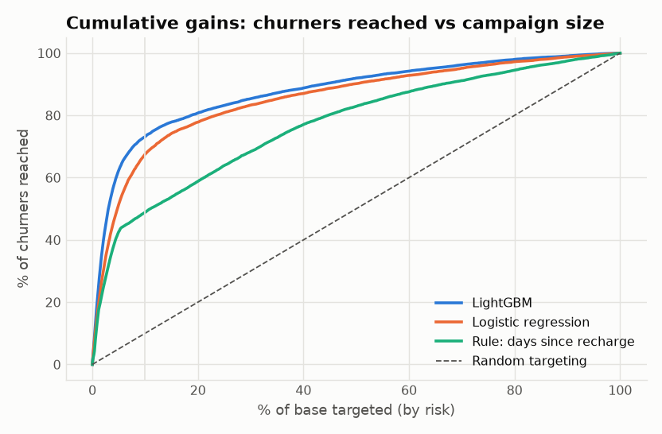
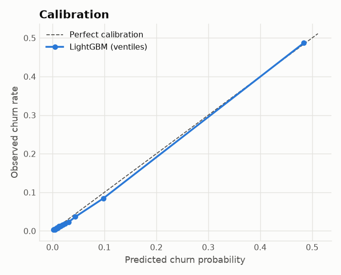
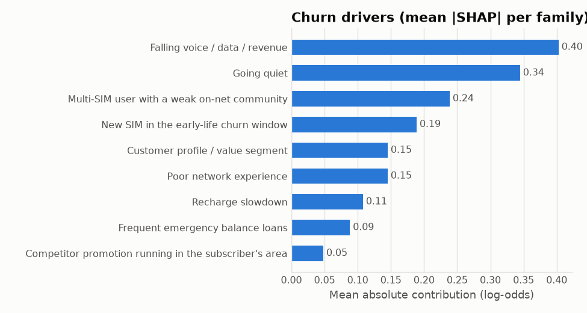
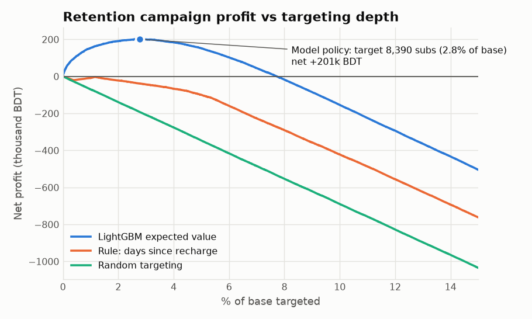

# Prepaid Mobile Churn Prediction — End-to-End ML System

**Predict which prepaid subscribers will go silent in the next 60 days, explain why, and decide who is worth a retention offer. Built for a Bangladesh-style mobile market (95%+ prepaid, multi-SIM, recharge-driven), at operator scale.**

<p>
  
  
  
  
  
</p>

| Out-of-time test month (Oct 2025, 302k subscribers, 3.9% churn) | LightGBM | Logistic regression | Business rule¹ |
|---|---|---|---|
| ROC-AUC | **0.892** | 0.868 | 0.780 |
| PR-AUC (average precision) | **0.552** | 0.404 | 0.256 |
| KS statistic | **0.661** | 0.616 | 0.407 |
| Precision in top 5% of base | **48.7%** (12.5× lift) | 40.1% | 33.3% |
| Churners caught in top 10% | **73.2%** (7.3× lift) | 67.6% | 48.9% |
| Retention campaign net value² | **+201k ৳** (8,390 subs targeted) | – | loss at every depth |

¹ "Longest time since last recharge = highest risk", the typical pre-ML CRM rule. ² Same campaign economics for every model. Random targeting at the same size loses 191k ৳, and a blanket offer to everyone loses 6.9M ৳.

| Speed (4 vCPU cloud container) | |
|---|---|
| Monthly scoring run, **1M active subscribers** (12M usage rows, 30M recharge transactions) | **52 s** end-to-end, 4.6 GB peak RAM |
| Monthly scoring run, 300k subscribers (features + scores + reason codes + campaign list + drift check) | 15 s |
| Raw model scoring throughput | ~120,000 subscribers/s |
| Real-time API, one subscriber incl. SHAP reason codes | ~3 ms model, ~5 ms HTTP round trip (p50) |
| Training on 1.56M snapshot rows × 82 features | ~60 s |

---

## Why this project exists (what was wrong with v1)

v1 of this repo was a typical "Kaggle Telco" project. It showed 75% accuracy, but in a real telco it would fail:

| v1 problem | Why it matters | v2 fix |
|---|---|---|
| IBM *US broadband* dataset (DSL, fiber, paperless billing) | Nothing like a prepaid mobile operator | Simulated operator **data warehouse**: subscribers, monthly usage, recharge transactions, network & market tables |
| A `Churn = Yes/No` column | Prepaid customers never "cancel"; they just stop recharging | **Churn defined from behaviour**: active this month, then zero usage and zero recharge for 60 days |
| ADASYN oversampling *before* the train/test split | Synthetic rows leak into the test set; the score is inflated | No resampling; **out-of-time** validation on a future month |
| "Accuracy" as the metric | At 4% churn, predicting "nobody churns" scores 96% | ROC-AUC, PR-AUC, KS, **lift & capture@top-k**, calibration, **profit** |
| Scaler/encoders re-fitted on each prediction request | Same customer gets different scores depending on the batch | Frozen feature contract + category levels saved in the model artifact |
| PyTorch MLP on 20 static columns; GNN/NLP code never used | Heavy and slow, no gain on tabular data | LightGBM (industry standard for tabular churn), 82 behavioural features |
| No explanation or action | A score alone doesn't tell a CRM team what to do | **SHAP reason codes → root-cause driver → next-best action**, profit-optimised targeting |

---

## Architecture

```
          ┌──────────────────── simulated operator DWH (parquet) ────────────────────┐
          │ subscribers │ usage_monthly │ recharges (event level) │ network_market   │
          └──────┬──────────────┬──────────────────┬─────────────────────┬───────────┘
                 └──────────────┴────────┬─────────┴─────────────────────┘
                                         ▼
                 Point-in-time feature snapshots (Polars, leakage-tested)
                 one row per active subscriber per month · 82 features · 60-day churn label
                                         │
            ┌────────────────────────────┼─────────────────────────────┐
            ▼                            ▼                             ▼
   Train (5 monthly snapshots)   Validate (Aug: early stop,    Test (Oct: untouched future
   LightGBM + baselines          risk-band thresholds,          month → all reported metrics)
                                 drift reference)
                                         │
                                         ▼
      artifacts/model: model.txt · metadata.json (features, category levels, thresholds) · drift_reference.json
                                         │
            ┌────────────────────────────┴─────────────────────────────┐
            ▼                                                          ▼
   Monthly batch scoring (`churn score`)                    Real-time API (`churn serve`)
   scores → risk bands → TreeSHAP reason codes              POST /v1/predict  (features → score + reasons)
   → primary driver → next-best action                      GET  /v1/subscribers/{id} (CRM / call-centre lookup)
   → expected-value targeting → campaign CSV                GET  /health · /v1/model
   → PSI drift report
```

---

## 1. Data: a simulated operator data warehouse

Real subscriber data can't be published, so `churn simulate` generates the extracts a churn team would pull from an operator's DWH. It uses the same grain and columns, and **churn emerges from behaviour** rather than being a random label.

| Table | Grain | Rows (300k base, 12 months) | Content |
|---|---|---|---|
| `subscribers` | SIM | 426k | activation month, division, urban/rural, handset (feature / 3G / 4G), prepaid/postpaid, dual-SIM, self-care app, MFS (bKash/Nagad-style) user |
| `usage_monthly` | subscriber × month (only if active) | 4.0M | voice & on-net minutes, data MB, SMS, data packs, revenue, **active days**, **last active day**, emergency-balance loans, complaints, experienced call-drop rate, data speed |
| `recharges` | top-up transaction | 10M | timestamp, amount (real denominations: 10, 20, 29, 49, 99 … ৳), channel (retailer / MFS / app / card) |
| `network_market` | division × month | 96 | avg call-drop rate, outages, **competitor promotion** flag |

**How churn is generated.** Each month, a subscriber's hazard of *starting to disengage* depends on:

- early-life SIMs (first 3 months)
- engagement and ARPU
- **multi-SIM** behaviour
- accumulated **dissatisfaction** (call drops, complaints)
- **competitor promos** in their division (a data-pack blitz in Rajshahi & Rangpur in Aug–Sep)
- a **July tariff hike** that hits price-sensitive users
- on-net community share, postpaid plan, app adoption
- an unobserved frailty term

Disengaging users wind usage and recharges down over 0–3 months, then go silent. To keep the problem realistically hard, some churn abruptly with no warning, some recover, and about 4% of loyal users have a *temporary dormant month* (village trip over Eid, using the other SIM, travelling abroad) that looks like churn but isn't. Other realistic details: Eid usage peaks, occasional users active only a few days a month, and rural network penalties.

## 2. Churn definition and snapshots

```
               lookback (features)            label window
        ┌───────────────────────────┐ ┌──────────────────────────┐
  ... │  Aug   │  Sep   │  Oct ◄cutoff│  Nov   │  Dec   │
                                    ▲
     subscriber must be active in Oct │   churn = 1 ⇔ no usage AND no recharge in Nov–Dec (≈60 days)
```

- One row per subscriber **active in the cutoff month**; features use data up to the last day of that month only.
- `tests/test_data_and_features.py::test_features_do_not_leak_future_data` deletes all data after the cutoff and asserts every feature value is unchanged.
- **Out-of-time split**, as it would run in production: standing at end-Oct, labels exist for cutoffs ≤ Aug. Train on Mar–Jul (1.56M rows), early-stop on Aug, report on **Oct** (a month the model has never seen). Score **Dec** ("today", no labels yet).

## 3. Features (82)

| Family | Examples | Business meaning |
|---|---|---|
| Activity & recency | `days_since_last_activity`, `days_active_m0..m2`, `days_active_trend` | Is the subscriber going quiet? |
| Recharge behaviour (from transactions) | `days_since_last_recharge`, `rch_cnt_30d/90d`, `rch_max_gap_days_90d`, `rch_amt_trend`, `rch_small_ticket_share_90d`, `rch_mfs_share_90d` | The #1 prepaid signal: longer gaps, smaller top-ups |
| Usage trends | `voice_min_trend`, `data_mb_trend`, `revenue_delta_1m`, `data_mb_per_active_day`, `onnet_share` | Declining usage; on-net community strength |
| Network experience | `drop_call_rate_m0/avg3m`, `data_speed_mbps_*`, `complaint_cnt_*`, `div_drop_rate_change`, `div_outage_m0` | Service quality the customer actually felt |
| Market | `competitor_promo_m0`, `competitor_promo_lb` | Competitor offers in the subscriber's division |
| Credit stress | `emergency_loan_cnt_*` | Frequent emergency balance use |
| Profile | tenure, handset, plan, division, urban, dual-SIM, app & MFS user, age | Segment & early-life effects |

Months before activation are `null` (unknown), not `0` (no usage), so trends aren't fabricated for new SIMs.

## 4. Model and evaluation

LightGBM (`lr 0.1, 31 leaves, depth 6`, early stopping on the validation month) against two baselines. All numbers are on the untouched October snapshot; see `reports/metrics.json`.

<p></p>
<p>
  
  
</p>

**Gains table** (`reports/gains_test.csv`): the top decile holds 28.5% churners (7.3× the base rate) and **73% of all churners**. Probabilities are well calibrated (Brier 0.024) without resampling, which the expected-value maths below depends on.

| Decile | Subscribers | Churners | Churn rate | Lift | Cumulative capture |
|---|---|---|---|---|---|
| 1 | 30,247 | 8,633 | 28.5% | 7.32 | 73.2% |
| 2 | 30,247 | 898 | 3.0% | 0.76 | 80.8% |
| 3 | 30,247 | 542 | 1.8% | 0.46 | 85.4% |
| … | | | | | |
| 10 | 30,247 | 107 | 0.4% | 0.09 | 100% |

## 5. From score to action: reason codes and next-best action

A retention agent can't act on `rch_max_gap_days_90d = +0.41`. LightGBM's native **TreeSHAP** contributions are grouped into 9 business driver families:

<p></p>

Families are split into **symptoms** (going quiet, falling usage, slower recharges) and **root causes** (early-life SIM, network experience, competitor offer, credit stress, multi-SIM). Symptoms dominate the score, but the offer has to address the *cause*. So the `primary_driver` is the strongest root cause, falling back to the strongest symptom, and it maps to a next-best action:

| Primary driver | Recommended action |
|---|---|
| `early_life` | Onboarding journey: bonus on 2nd/3rd recharge + app sign-up reward |
| `network_experience` | Proactive care call, network ticket for the serving site, goodwill minutes |
| `competitor_pressure` | Geo-targeted, price-matched data-pack counter-offer |
| `credit_stress` | Higher emergency-balance limit / micro packs |
| `multi_sim_low_loyalty` | "Primary SIM" loyalty offer: on-net minutes + FnF bonus |
| `recharge_slowdown` / `inactivity` / `usage_decline` | Recharge bonus on usual denomination / win-back nudge / usage bundle |

December campaign list by driver: early-life 42%, credit stress 21%, multi-SIM 15%, network 15%.

## 6. Who to target: campaign economics

The highest churn probability is not the same as the most valuable target. A 90%-risk subscriber paying 30 ৳/month is worth less than a 40%-risk subscriber paying 800 ৳. For each subscriber:

```
value_if_saved = save_rate (30%) × margin (55%) × ARPU × 6 months
cost           = contact (2 ৳) + redeem_rate (60%) × offer (40 ৳)
expected_net   = p(churn) × value_if_saved − cost            → target if > 0
```

<p></p>

On the test month, the policy targets 2.8% of the base and nets **+201k ৳**. That's within 0.4% of the best achievable in hindsight (201.9k at 7,924 subs). The recency rule never beats zero, random targeting at the same size loses 191k ৳, and a blanket offer to everyone loses 6.9M ৳. All assumptions live in `configs/config.yaml → campaign`.

> **Caveat for interviews:** `save_rate` is an assumption. In production it is measured with a **randomised hold-out control group**; the next step is an uplift model (see roadmap).

## 7. Production pieces

**Batch scoring** (`churn score --month 2025-12`) writes:

- `outputs/scores_2025-12.parquet`: every active subscriber, with probability, risk band (critical/high/medium/low, from validation-month quantiles), risk rank, expected value
- `outputs/campaign_2025-12.csv`: the targeted list sorted by expected value, with `reason_1`, `reason_2`, `primary_driver`, `recommended_action`, ready for a CRM / campaign tool

TreeSHAP costs ~1000× a plain prediction, so batch runs explain only the rows that get actioned (critical band plus campaign targets). The API explains every request.

**Real-time API** (`churn serve`, FastAPI):

```bash
curl localhost:8000/v1/subscribers/138803
```
```json
{
  "sub_id": 138803, "division": "Dhaka", "tenure_months": 166, "arpu_3m": 499.0,
  "churn_probability": 0.819, "risk_band": "critical", "expected_net_value": 378.6, "target": true,
  "reasons": [{"code": "inactivity", "description": "Going quiet: fewer active days, long time since last activity"},
              {"code": "usage_decline", "description": "Falling voice / data / revenue"}],
  "primary_driver": "multi_sim_low_loyalty",
  "recommended_action": "'Primary SIM' loyalty offer: on-net minutes + FnF bonus"
}
```

`POST /v1/predict` accepts up to 10k feature vectors (e.g. from a feature store or a CRM event). Missing features and unknown categories are handled as NaN, never re-fitted. Inference runs on a dense NumPy matrix with frozen category codes, bypassing pandas: ~0.04 ms per prediction, ~3 ms with SHAP reasons.

**Drift monitoring.** Every scoring run computes the **PSI** of each feature and of the score against the validation-month reference (`reports/drift_<month>.json`): < 0.10 stable, 0.10–0.25 investigate, > 0.25 retrain. Division-level market context is excluded because it changes month to month by design.

## Quick start

```bash
git clone https://github.com/noushad999/telecom-churn-prediction.git
cd telecom-churn-prediction
python -m venv .venv && source .venv/bin/activate
pip install -e ".[dev]"

churn pipeline                       # simulate 300k-sub operator → train → score (≈3 min)
churn serve                          # API on http://localhost:8000/docs
pytest                               # 20 tests, ≈10 s

churn pipeline --subscribers 1000000 # operator-scale run
```

Or use `make pipeline`, `make serve`, `make test`, `make docker`.

## Project structure

```
configs/config.yaml        all knobs: simulation, churn definition, splits, LightGBM, campaign economics, risk bands
src/churn/
  simulate.py              behavioural data-warehouse simulator (vectorised NumPy → Polars/parquet)
  features.py              point-in-time snapshots + 60-day inactivity label (Polars)
  train.py                 out-of-time training, baselines, evaluation, artifact export
  evaluate.py              AUC / PR-AUC / KS / lift / capture / gains table + charts
  explain.py               SHAP → driver families → primary root cause → next-best action
  campaign.py              expected-value targeting and profit curves
  model.py                 frozen model artifact, fast NumPy inference path
  score.py                 monthly batch scoring, campaign list, drift check
  monitor.py               PSI drift monitoring
  api.py                   FastAPI service
  cli.py                   `churn simulate | train | score | pipeline | serve`
tests/                     leakage, label definition, simulator invariants, business logic, API
reports/                   metrics.json, gains table, charts (committed so results are visible)
docs/interview_guide.md    design decisions & likely interview questions
```

## Using real operator data

Replace `simulate.load_tables` with extracts that match the four table schemas above. `features.py`, training, scoring and the API work unchanged. In a real deployment, typical changes are:

1. Snapshots built in the warehouse (Spark/SQL) or a feature store instead of in-memory Polars.
2. Churn definition aligned with the operator's finance definition (60 vs 90 days, revenue-generating events only).
3. `save_rate` and offer costs measured from control groups.
4. Monthly retraining triggered by PSI alerts or performance decay.

## Roadmap

- **Uplift modelling** (T-/X-learner on campaign response): target *persuadable* subscribers, not just risky ones
- **Social-network features** from call graphs (churn is contagious among frequent contacts)
- **Survival model** (time-to-churn) for CLV-aware offers
- Optuna tuning, MLflow tracking, Airflow/Prefect monthly schedule

## Limitations

The data is simulated. The simulator encodes domain knowledge of prepaid markets, so absolute numbers (AUC, ৳ values) show the method, not a specific operator's results. The value of the project is the system design: churn definition, leakage-safe snapshots, out-of-time evaluation, explainability, economics, serving and monitoring.

---

**Md Noushad Jahan Ramim**, Dhaka, Bangladesh · MIT License
